# 🚀 Awesome CRM & Customer Relationship Management

  

  
  
  
  
  
  

---

## 🌟 Top CRM & Customer Relationship Management Ecosystem

> **A comprehensive, SEO-optimized curated directory of enterprise SaaS platforms and self-hosted open-source CRM systems.**  
> *Track, automate, organize, and accelerate sales pipelines, lead routing, customer relationship intelligence, outbound outreach, and RevOps workflows.*

📅 **Last updated:** November 2026

This directory tracks the most impactful **SaaS/hosted CRM software** and **self-hosted open-source CRM repositories** available today. Whether you are an enterprise sales leader scaling thousands of pipeline opportunities, a startup founder looking for lightweight deal boards, a RevOps engineer automating lead funnels, or an IT administrator demanding full customer data sovereignty with on-premise Docker deployments, this guide serves as your authoritative reference.

---

## 📑 Table of Contents

- [📊 Sector Overview & Market Dynamics](#-sector-overview--market-dynamics)
- [☁️ SaaS / Hosted Platforms](#️-saashosted-platforms)
- [💻 Open-Source GitHub Projects](#-open-source-github-projects)
- [🛠️ Ecosystem Integrations & Workflows](#️-ecosystem-integrations--workflows)
- [🤝 How to Contribute](#-how-to-contribute)
- [📈 Star History](#-star-history)
- [💖 Support & Sponsorship](#-support--sponsorship)
- [⚖️ Disclaimer](#️-disclaimer)

---

## 📊 Sector Overview & Market Dynamics

The global Customer Relationship Management (CRM) software market reached an estimated valuation of **$75–80+ Billion in 2024–2025** and is projected to expand beyond **$140+ Billion by 2030** at an annual CAGR of ~12–14%. 

The sector exhibits **moderate concentration with barbell fragmentation**: enterprise market share is anchored by mega-cap platforms (**Salesforce**, **Microsoft**, **HubSpot**), while the mid-market and SME tiers remain highly contested by specialized SaaS solutions (such as **Zoho**, **Pipedrive**, and **Freshsales**) alongside an accelerating wave of **self-hosted open-source CRMs** (such as **Twenty**, **Odoo**, and **EspoCRM**) driven by data privacy, GDPR mandates, and developer extensibility.

---

## ☁️ SaaS / Hosted Platforms

| 🏢 Platform | 💰 Company Size (Valuation / Revenue) | 🏷️ Starting Pricing | 🎁 Free Tier Limits / Free Trial | 📝 Description |
| :--- | :--- | :--- | :--- | :--- |
| **[Microsoft Dynamics 365 Sales](https://microsoft.com)** | **$3.1T+** Market Cap (Microsoft parent; $245B+ total annual revenue) | $65/user/month (Sales Professional, billed annually) | No free tier; 30-day free trial with full feature access | Enterprise CRM platform deeply integrated with Microsoft 365, Teams, LinkedIn Sales Navigator, and Copilot AI relationship intelligence. |
| **[Salesforce Sales Cloud](https://salesforce.com)** | **$250B+** Market Cap ($38B+ annual revenue) | $25/user/month (Starter Suite, billed monthly or annually) | No free tier; 30-day free trial with full feature access (no credit card required) | Industry-leading enterprise cloud CRM platform offering customizable sales pipelines, Agentforce AI automation, forecasting, AppExchange integrations, and enterprise governance. |
| **[HubSpot CRM](https://hubspot.com)** | **$21B+** Market Cap ($3.1B+ annual revenue) | $15/user/month (Sales Hub Starter, billed annually) or $20/month | Free forever tier: up to 2 users, 1,000 marketing contacts (up to 1M standard records), 1 deal pipeline, 2,000 email sends/month, HubSpot branding included; 14-day free trial for paid tiers | All-in-one inbound marketing, sales pipeline, and customer service CRM featuring contact activity timelines, email tracking, deal boards, and workflow automation. |
| **[Zoho CRM](https://zoho.com)** | **$12.5B** Estimated Valuation ($1.4B+ annual revenue, bootstrapped/profitable) | $14/user/month (Standard, billed annually) or $20/user/month | Free forever tier: up to 3 users, 5,000 records, standard lead/contact/deal management; 15-day free trial for paid editions | Comprehensive cloud CRM suite offering omnichannel communication, workflow automation, Zia AI analytics, and tight integration across the Zoho business ecosystem. |
| **[Zendesk Sell](https://zendesk.com)** | **$10.2B** Acquisition Valuation ($1.7B+ annual revenue, acquired by H&F/Permira) | $19/user/month (Sell Team, billed annually) | No free tier; 14-day free trial (eligible for a 14-day extension via admin portal) | Sales productivity CRM uniting lead management, call/email tracking, and seamless visibility into customer support tickets from Zendesk Service. |
| **[Freshsales (Freshworks)](https://freshworks.com)** | **$3.6B+** Market Cap ($720M+ annual revenue) | $9/user/month (Growth, billed annually) or $11/user/month | Free forever tier: up to 3 users, contact/account/deal management, Kanban view, built-in chat/email/phone; 21-day free trial for Pro/Enterprise | AI-assisted cloud CRM combining visual deal pipelines, built-in cloud telephony, behavioral lead scoring, and automated outreach sequences. |
| **[Copper](https://copper.com)** | **$2.0B** Peak Private Valuation ($100M+ funding raised) | $23/user/month (Basic, billed annually) or $29/user/month | No free tier; 14-day free trial (Basic tier capped at 2,500 contacts, Professional at 15,000 contacts) | CRM purpose-built for Google Workspace teams, embedding contact management, deal tracking, and automated email logging directly inside Gmail and Google Calendar. |
| **[Pipedrive](https://pipedrive.com)** | **$1.5B** Acquisition Valuation (Acquired by Vista Equity Partners) | $14/user/month (Lite, billed annually) or $24/user/month | No free tier; 14-day free trial (300,000 open deals account-wide limit, unlimited contacts) | Sales-first visual pipeline CRM engineered for small and mid-sized sales teams with activity-based selling, email sync, and AI deal insights. |
| **[Insightly](https://insightly.com)** | **$150M+** Estimated Valuation (~$37M estimated ARR, $38M venture funded) | $29/user/month (Plus, billed annually) | No free tier (legacy free tier discontinued); 14-day free trial for Plus and Professional (100,000 records & 10 GB storage on Plus) | Unified cloud CRM and post-sale project delivery platform connecting sales pipelines directly to client onboarding workflows and custom objects. |
| **[Close CRM](https://close.com)** | **$120M+** Estimated Valuation ($30M+ ARR, bootstrapped/profitable) | $9/user/month (Solo, billed annually) or $19/month | No free tier; 14-day free trial including calling/AI test credits (Solo capped at 1 user and 10,000 leads) | High-velocity sales CRM built for inside sales and B2B outbound teams featuring built-in power/predictive dialers, SMS, email sequences, and call coaching. |

---

## 💻 Open-Source GitHub Projects

Sorted in descending order by GitHub repository star counts:

1. **[Twenty](https://github.com/twentyhq/twenty)**   
   Modern, sleek open-source CRM (Salesforce and Attio alternative) built with TypeScript, React, and NestJS featuring Notion-like UI, custom objects, Kanban views, and GraphQL/REST APIs.

2. **[Odoo CRM](https://github.com/odoo/odoo)**   
   Modular open-source business and ERP suite featuring a visual Kanban CRM pipeline, VoIP/email integration, automated lead scoring, and seamless connection to invoicing, inventory, and e-commerce.

3. **[ERPNext](https://github.com/frappe/erpnext)**   
   Full-featured, modern open-source enterprise suite built on Frappe and Python, offering complete CRM lifecycle management, customer communications, quotes, sales orders, and accounting.

4. **[Monica PRM](https://github.com/monicahq/monica)**   
   Popular open-source Personal Relationship Management (PRM) system designed to organize personal and professional contacts, reminders, notes, interactions, and life milestones.

5. **[Krayin CRM](https://github.com/krayin/laravel-crm)**   
   Modern open-source CRM built on Laravel and Vue.js designed for SMEs and startups with visual lead pipelines, custom attributes, email integration, and activity scheduling.

6. **[Mautic](https://github.com/mautic/mautic)**   
   World's leading open-source marketing automation and lead nurturing platform pairing seamlessly with CRMs for inbound campaign automation, multi-channel attribution, and form capture.

7. **[Dolibarr ERP & CRM](https://github.com/Dolibarr/dolibarr)**   
   All-in-one modular open-source PHP/MySQL CRM and ERP suite enabling small businesses, non-profits, and freelancers to manage prospects, customers, proposals, orders, and billing.

8. **[GLPI](https://github.com/glpi-project/glpi)**   
   Extensible open-source IT asset, customer service, contract lifecycle, and relationship management platform featuring ticketing, supplier contracts, and CRM-style service desks.

9. **[SuiteCRM](https://github.com/salesagility/SuiteCRM)**   
   Enterprise-grade open-source CRM (forked from SugarCRM) offering complete sales force automation, marketing campaigns, customer support case tracking, quotes, and reports.

10. **[erxes](https://github.com/erxes/erxes)**   
    Open-source, self-hosted experience operating system (XOS) combining CRM, team inbox, sales pipelines, marketing automation, and customer feedback into a unified hub.

11. **[Frappe CRM](https://github.com/frappe/crm)**   
    Ultra-clean, modern dedicated open-source CRM built on the Frappe framework featuring customizable deal stages, call logs, WhatsApp/email integration, and native Frappe interoperability.

12. **[EspoCRM](https://github.com/espocrm/espocrm)**   
    Flagship fast, lightweight self-hosted open-source CRM web application featuring custom entities/layouts, Kanban deal pipelines, calendar/email sync, BPM workflows, and REST APIs.

13. **[Corteza Project](https://github.com/cortezaproject/corteza)**   
    Self-hosted 100% open-source, Salesforce-compatible low-code digital work platform built with Go and Vue.js for managing complex enterprise CRM architectures.

14. **[YetiForce CRM](https://github.com/YetiForceCompany/YetiForceCRM)**   
    Feature-rich enterprise open-source CRM system providing advanced sales automation, inventory, quote calculations, tickets, and rigorous GDPR/data privacy compliance modules.

15. **[CiviCRM Core](https://github.com/civicrm/civicrm-core)**   
    Constituent Relationship Management (CRM) platform built specifically for non-profits, NGOs, humanitarian foundations, advocacy groups, and civic associations.

---

## 🛠️ Ecosystem Integrations & Workflows

Power your CRM architecture by combining best-of-breed open-source modules:

* 🗄️ **Relational Backends:** **[NocoDB](https://github.com/nocodb/nocodb)** and **[Baserow](https://github.com/bram2w/baserow)** for Airtable-style relational databases ideal for agile, custom pipeline trackers.
* 💬 **Omnichannel Messaging:** **[Chatwoot](https://github.com/chatwoot/chatwoot)** for linking live customer support chat, WhatsApp, and email inboxes directly to your CRM contacts.
* 📅 **Inbound Scheduling:** **[Cal.com](https://github.com/calcom/cal.com)** for self-hosted meeting scheduling that routes demo bookings straight into deal stages.
* 🔄 **Workflow Automation:** **[n8n](https://github.com/n8n-io/n8n)** for syncing customer data, webhook handling, and AI follow-up sequences across your CRM stack.

---

## 🤝 How to Contribute

Contributions are warmly welcomed! Please follow these simple guidelines:

1. 🍴 **Fork the repository**.
2. 🌿 Create a descriptive feature branch (`git checkout -b feature/add-new-crm`).
3. 📝 Add your entry to `README.md` following the existing format (include repository URL, star badge, and clear summary).
4. 🚀 Submit a Pull Request describing your additions.

---

##  Star History

---

## 💖 Support & Sponsorship

Thank you so much for exploring and using this repository! If you find this curated CRM guide helpful, please consider supporting its ongoing maintenance and updates:

- ⭐ **Star this repository** to help others discover it across GitHub.
- 🍴 **Fork & Share** it with your team, founders, and RevOps colleagues.
- ☕ **Buy me a coffee / Sponsor**: Support my open-source work directly through the [GitHub Sponsor Dashboard](https://github.com/sponsors/ishandutta2007) — every coffee and contribution helps maintain high-quality open-source ecosystem lists!

---

## ⚖️ Disclaimer

- This is an independent **community-curated** list — inclusion does not represent an endorsement.
- Customer relationship databases store sensitive personal identifiable information (PII), email histories, and commercial pipeline transactions. Always ensure deployments enforce SSL/TLS, strict RBAC, automated off-site backups, and GDPR/CCPA regulatory compliance.
- Open-source licenses vary (e.g., AGPL-3.0, GPL-3.0, MIT, Apache-2.0); verify each repository's license conditions prior to commercial deployment or redistribution.

---

  <b>Built with ❤️ for sales teams, developers, founders, and the open-source community.</b>

